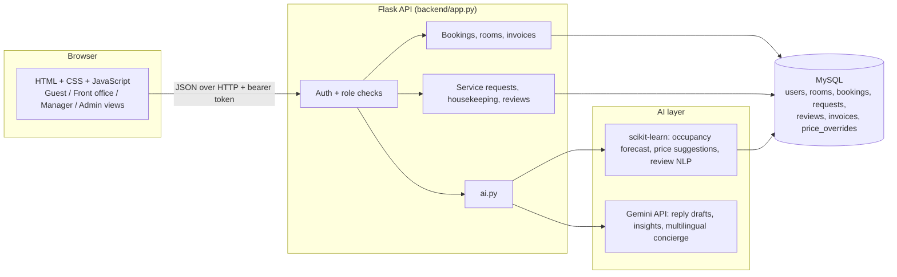

# Architecture

Data flow for dynamic pricing: bookings table -> daily occupancy (pandas) -> GradientBoosting forecast + festival flag -> price multiplier -> manager approval -> `price_overrides` -> prices shown to guests in availability search.
